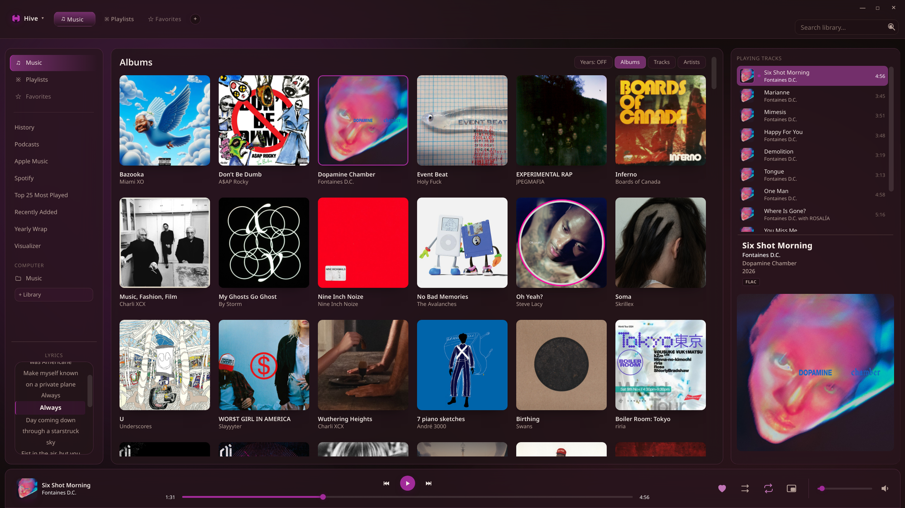
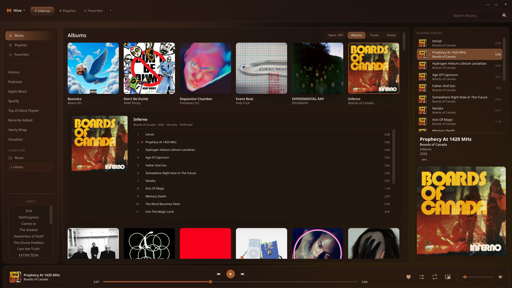
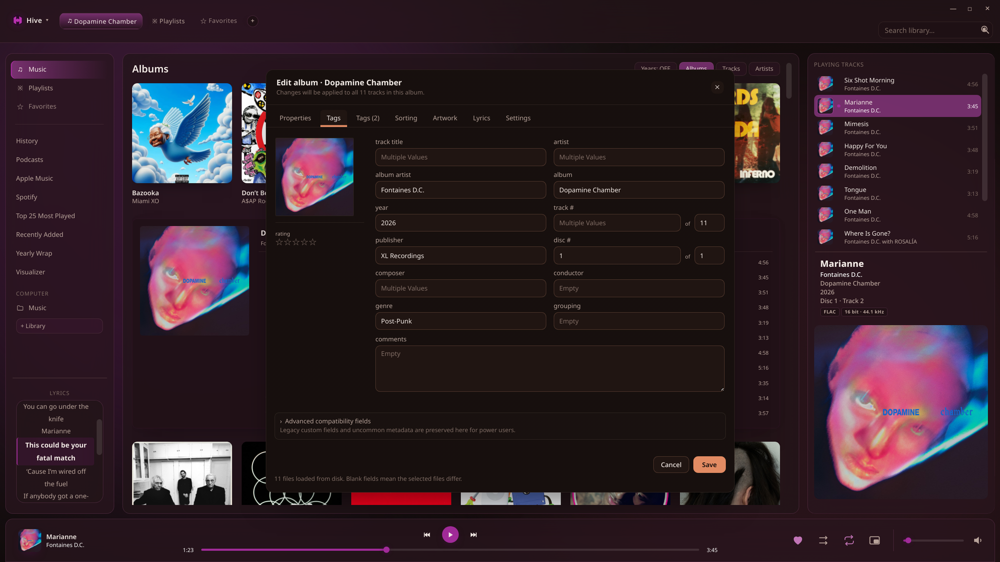
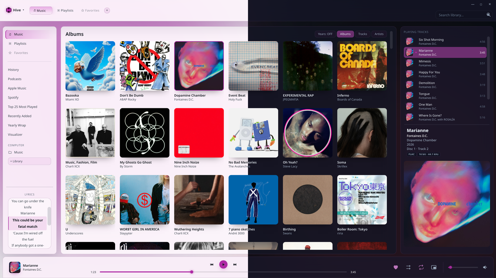
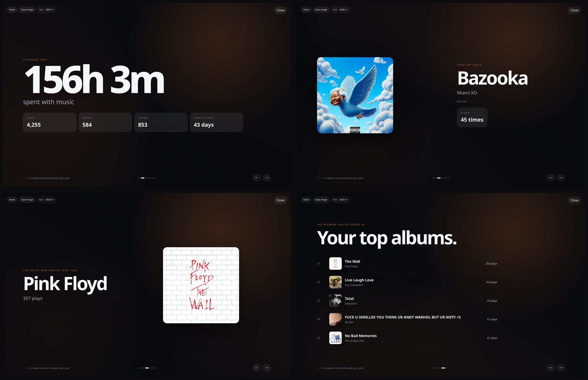
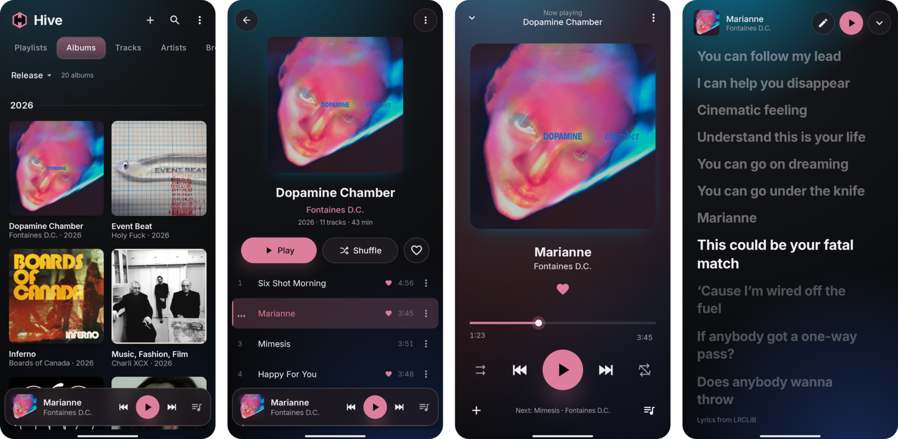

<p align="center">
  
</p>

<h1 align="center">Hive</h1>

<p align="center">
  <strong>An offline music library manager and player.</strong>
</p>

<p align="center">
  Local music. Native playback. Your metadata stays yours.
</p>

<p align="center">
  <a href="https://github.com/chasesfloorboard/Hive/releases">Download Hive</a>
  ·
  <a href="https://github.com/chasesfloorboard/Hive/issues">Report an issue</a>
  ·
  <a href="https://github.com/chasesfloorboard/Hive/blob/main/CONTRIBUTING.md">Contributing</a>
</p>

---

Hive is a Linux-first desktop music player built around your local library. It combines native GStreamer playback with a focused Electron interface for large collections, embedded metadata, artwork, playlists, queue management, and library tools.



## Built for your library

Hive is designed around the idea that your music library should remain useful outside of any one application.

- **Native GStreamer playback** — local playback with gapless support and ReplayGain-aware behavior.
- **Embedded metadata** — Favorites, ratings, and tags are written to the music files through Hive's bundled Mutagen backend.
- **Large-library management** — scanning, MusicBrainz-assisted matching, artwork lookup, and library organization.
- **Playlists & queue** — persistent playlists, queue management, and Favorites as a first-class library view.
- **Full tag editor** — individual and bulk metadata editing, artwork, lyrics, and advanced fields.
- **Yearly Wrap** — private, local listening statistics with MusicBee Wrapped archive import.
- **Portable by design** — the application, settings, and library database can live together in one folder, including on a removable drive.
- **Local-first privacy** — your library data and listening history stay local unless you explicitly use an optional integration.

## See Hive in action

### Albums first

Covers lead. Click an album and its tracklist opens right in the grid; the window takes its colours from whatever is playing.



### Tag editing

Edit one song or a whole album without leaving the player: titles, artists, album, year, track and disc numbers, genre, label, lyrics, ratings and artwork, written straight into the files.



### Themes

Light, dark and a set of colour themes, each still tinted by the album that's playing. Themes can also switch by time of day.



### Yearly Wrap

Hive turns its own play history into a private yearly summary: listening time, your top track, artist and albums, and your year month by month. Nothing leaves your computer.



### Hive Mobile

The same library on your Android phone: albums, an album page, the player, and synced lyrics.



## Installation

Download the latest release from the [GitHub Releases](https://github.com/chasesfloorboard/Hive/releases) page, extract it, and run:

```bash
tar -xzf Hive-*.tar.gz
cd Hive
./install.sh
```

The installer sets up Hive's dependencies, Electron runtime, native GStreamer helper, desktop entry, and MPRIS integration.

### Windows

Download `Hive-<version>-Win-x64.zip`, extract it, and run `Hive\Hive.exe`. Nothing else to install: the zip includes Hive's audio engine (GStreamer) and Python. Windows 10 or 11, 64-bit.

On Windows, Hive plays the same formats as on Linux (MP3, FLAC, AAC/ALAC/M4A, Ogg Vorbis, Opus, WMA, WavPack, APE, WAV, AIFF and more). Linux-only features: bit-perfect output, output-device selection, and syncing to a phone over MTP (USB file transfer). Spotify and Apple Music songs play in full inside Hive; Hive never needs the Spotify app. Media keys, the tray icon and Hive Mobile (below) work on both.

The build is not code-signed yet, so Windows SmartScreen may warn the first time: choose **More info → Run anyway**. Maintainers build the zip on Linux with `scripts/build-windows.sh`.

### Hive Mobile (Android)

Hive Mobile is a music player for Android 10 or newer. It plays the music on your phone and, if you like, keeps it in step with Hive on your computer.


**Install:** download `HiveMobile.apk` from the [`hive-mobile` release](https://github.com/chasesfloorboard/Hive/releases/tag/hive-mobile) on your phone and open it (Android asks once to allow installing apps from your browser or file manager). After that, updates come to the app itself: Settings › Connections › App updates shows **Update available**, from Hive on your computer or from this release when the computer is off. Your library, favorites and settings stay through every update.

**On the phone:**

- Albums, artists, tracks, playlists and smart playlists, with covers throughout. Hold an album's cover to see it full size, save it to your photos, or change it.
- A full player with synced lyrics, gapless playback, crossfade, an equaliser, ReplayGain and Auto DJ; a home-screen widget, an optional lock-screen player, and Android Auto.
- Edit tags and covers, auto-tag albums, and edit lyrics, written into the song files.
- Favorites (Love) are written into the song files too, the same way Hive on the computer writes them, so they survive anything.
- A Yearly Wrap of your listening, month by month.
- Uninstalling never loses anything: Hive Mobile keeps a backup of itself on the phone (and on your computer, if paired), and a fresh install offers to restore it exactly as it was.
- It works on its own with no computer and no account.

**With Hive on your computer** (optional): in Hive Mobile, Settings › Hive on your PC. With **Connect automatically** on, the phone finds Hive on the same Wi-Fi and asks to connect; Hive on the computer asks you to **Allow** it once. Or pair with the code from Hive's Settings › Connections › Hive Mobile › Pair phone. Nothing connects without your approval on the computer.

- **What syncs:** favorites both ways, plays (they count in Yearly Wrap on both sides), ratings and playlists, the theme, tag and cover edits made on the phone, and, with **song sync** on, the songs themselves: each side gets the songs it lacks, file for file. Songs deleted on one side are never deleted on the other without asking you.
- Everything stays between your phone and your computer on your own network (or your own VPN); nothing goes through a server.

The APK is signed by the maintainer but not distributed through the Play Store. To build it yourself: `cd mobile/android && ./gradlew assembleRelease` (JDK 21 and the Android SDK), then install `app/build/outputs/apk/release/app-release.apk`.

### Portable mode

Hive can run as a self-contained portable installation. Keep the whole Hive folder together and it stores its application data in `Hive Data/` beside the installation.

This makes it possible to keep Hive and a music library together on an external or removable drive.

## Requirements

These are for the Linux build; the Windows zip is self-contained.

- Linux
- Node.js and npm
- Python 3
- GStreamer 1.0 development/runtime packages
- A C compiler
- `ffmpeg`
- `metaflac` for applicable metadata formats

## Development

```bash
npm ci --ignore-scripts
npm test
npm run check
npm start
```

Automated tests use controlled test data; Hive does not need access to a developer's real music library to run the test suite.

## Safety & data ownership

Hive is intentionally local-first:

- GStreamer is the sole native playback owner.
- Embedded metadata is authoritative for Favorites/Love.
- Metadata jobs are journaled and verified after writes.
- Metadata and artwork writes are restricted to configured library folders.
- The renderer uses context isolation and a narrow preload bridge.
- Crash reporting is local-only.
- Updates are checked and installed only with user consent.

For the deeper architecture and security model, see [`docs/ARCHITECTURE.md`](docs/ARCHITECTURE.md).

## Documentation

- [`CLAUDE.md`](CLAUDE.md) — project briefing and development rules
- [`AI-DEVELOPMENT.md`](AI-DEVELOPMENT.md) — AI-assisted development notes
- [`docs/`](docs/) — architecture and feature documentation
- [`CONTRIBUTING.md`](CONTRIBUTING.md) — contribution guide
- [`SECURITY.md`](SECURITY.md) — security policy
- [`CHANGELOG.md`](CHANGELOG.md) — development history

## License

Hive is released under the MIT License. See [`LICENSE`](LICENSE).

